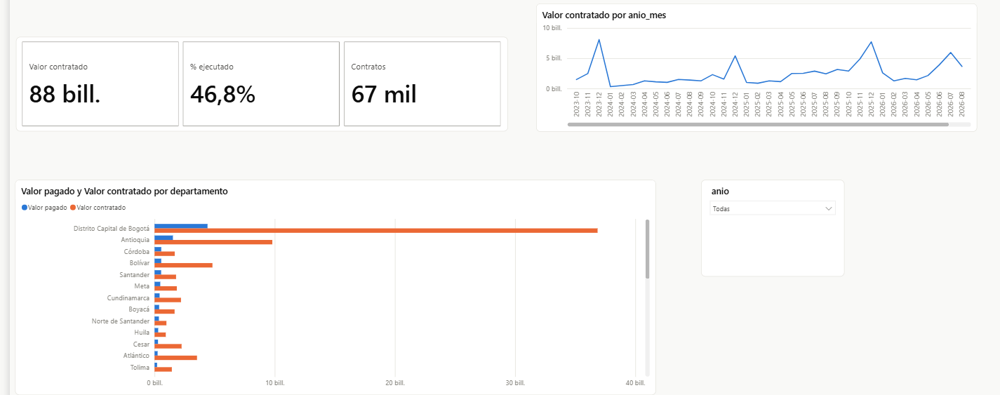
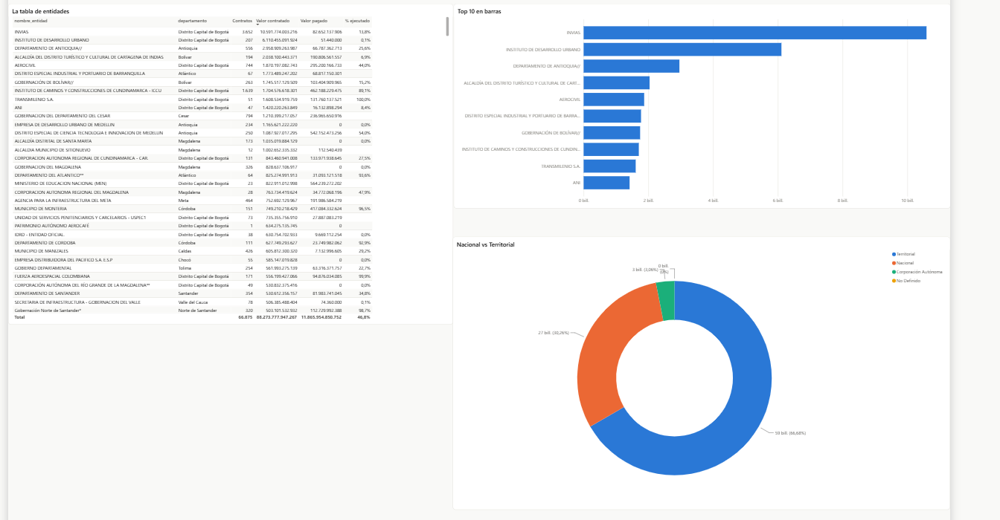
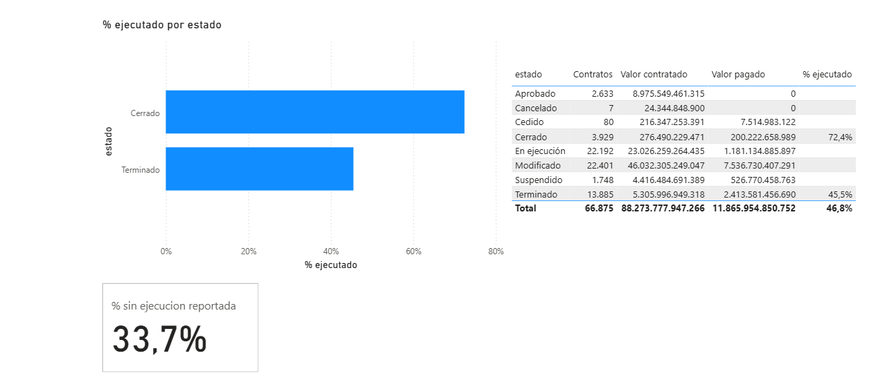
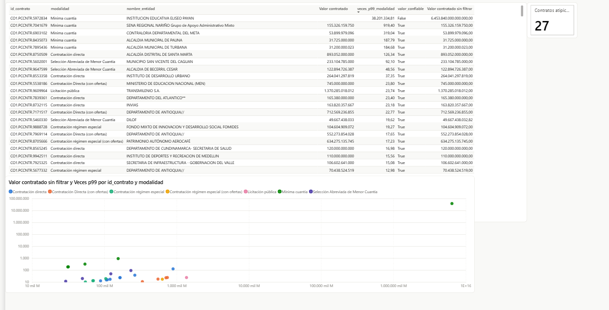

# Contratación de infraestructura en Colombia

[](https://github.com/brandoeci/secop-infraestructura/actions/workflows/ci.yml)

Proyecto de datos de punta a punta sobre el gasto público en obra e infraestructura, con datos
abiertos de **SECOP II**, la plataforma de contratación estatal de Colombia.

**Pipeline medallion** (bronze → silver → gold) sobre un dataset de **6.102.286 contratos**,
con claves deterministas, carga incremental, control de calidad que bloquea la publicación y
ejecución automática en GitHub Actions. Ingesta en Python, transformación en **dbt + DuckDB**,
informe en **Power BI**.

---

## La pregunta que responde

**¿En qué se gasta la plata de infraestructura en Colombia?** Quién contrata, cuánto se ejecuta
de verdad frente a lo contratado, qué departamentos concentran el dinero y qué contratos se
salen del patrón.

---

## El informe

Cuatro páginas, una por pregunta. Las capturas salen del informe publicado.

📄 **[Ver el informe completo en PDF](docs/informe-secop-infraestructura.pdf)** — las cuatro
páginas tal como se ven en Power BI, sin necesidad de cuenta ni de instalar nada.

> El informe está publicado en Power BI Service y se actualiza desde `data/curated/`, pero el
> enlace anónimo no está disponible: el tenant desde el que se publica tiene deshabilitada la
> opción *Publicar en la web*. De ahí el PDF.

### Resumen — cuánto y dónde



Las tres cifras de cabecera y la brecha entre lo contratado y lo pagado por departamento.
Bogotá concentra el 41,8 % del valor contratado.

### Quién contrata



**INVÍAS es la entidad que más contrata** por valor, con $10,59 billones. Y la plata la mueven
las regiones: **66,1 % territorial** contra 30,3 % nacional.

### Ejecución



El `% ejecutado` solo se calcula donde el pago es exigible, por eso el gráfico muestra únicamente
los estados *Cerrado* y *Terminado*. La tarjeta publica lo que normalmente se omite: **el 33,7 %
del valor con pago exigible no reporta ejecución**.

### Atípicos



Los 27 contratos que superan diez veces el percentil 99 de su propia modalidad. Los dos ejes van
en escala logarítmica porque el rango cubre cinco órdenes de magnitud en valor y casi siete en
veces el p99.

La primera fila de la tabla es el registro corrupto, y se lee sin explicación: `valor_confiable`
en `False`, la columna sin filtrar en 6,45 cuatrillones y `Valor contratado` **en blanco**, porque
todas las medidas de dinero lo excluyen.

---

## Hallazgos

Todas las cifras salen de correr el código de este repositorio contra la API de datos.gov.co
el **2026-10-05**. Ninguna está estimada.

### La obra pública es menos del 1 % de los contratos

De los 3.030.270 contratos firmados en los últimos tres años, el **86,84 % es prestación de
servicios** y solo el **0,83 % está clasificado como obra**. Eso obligó a buscar el gasto de
infraestructura más allá del tipo de contrato.

### Los dos criterios para identificar infraestructura casi no se solapan

| Criterio | Contratos |
|---|---|
| Por tipo de contrato (obra, interventoría, consultoría, concesión, APP) | 36.317 |
| Por categoría UNSPSC de construcción (`V1.72`) | 43.176 |
| **Cumplen los dos** | **12.618** |
| **Universo final (unión)** | **66.875** |

Filtrar solo por tipo pierde 30.558 contratos con categoría de construcción, la mayoría
registrados como «prestación de servicios». Filtrar solo por UNSPSC pierde 23.699, entre ellos
los 7.519 contratos de obra cuya categoría viene como `UNSPECIFIED`. El universo es la unión de
ambos.

### Un solo registro valía el 98,6 % del total

Sumar el valor contratado daba **$6.542 billones COP**, unas cuatro veces el PIB anual de
Colombia para tres años de obra. La causa era **un contrato** de
**$6.453.840.000.000.000** (6,45 cuatrillones de pesos).

Es un error de digitación, y tres campos del propio registro lo delatan: está clasificado como
**mínima cuantía** (modalidad cuya mediana es $33,8 millones y su percentil 99 son $169
millones), duró **menos de tres meses**, y supera el percentil 99,99 del universo unas 10
millones de veces.

| | Con el registro | Sin el registro |
|---|---|---|
| Valor contratado | $6.542,11 B | **$88,27 B** |
| Departamento con más valor | `No Definido` (98,7 %) | Bogotá D.C. (41,8 %) |

De ahí sale la regla de detección de atípicos del modelo: comparar cada contrato contra el
percentil 99 de **su propia modalidad de contratación**, no del universo, porque la modalidad
refleja un rango de cuantía definido por ley.

### La ejecución reportada pasa de 13,4 % a 46,8 % según cómo se mida

El **61,8 % del universo reporta cero pagado**. En contratos aprobados o en ejecución eso es
plausible; en contratos ya terminados no lo es.

| Medida | Resultado |
|---|---|
| `% ejecutado` sobre todo el universo | 13,4 % |
| Acotado a los 17.814 contratos ya terminados | **46,8 %** |

El 13,4 % no describe la realidad: mezcla contratos que todavía no tenían por qué haber pagado
nada. Aun acotando, **5.234 de 13.885 contratos terminados reportan cero pagado**. Esa brecha
se publica como medida propia del informe en lugar de esconderla: cuánto del gasto de
infraestructura no tiene ejecución reportada es un resultado en sí mismo.

### Una fecha en el año 0206 rompía la tabla de fechas

Un contrato trae la fecha de fin en el **año 0206** (casi seguro 2026). Esa sola fila estiraba
la tabla de fechas del modelo a **675.699 filas**, unos 1.850 años. Con la ventana de fechas
plausibles quedó en 13.879.

La ventana llega hasta 2060 a propósito: **94 contratos terminan después de 2035** y son
concesiones de obra a 20 y 30 años, no errores.

---

## Datos

| Fuente | Dataset | Tamaño |
|---|---|---|
| SECOP II – Contratos Electrónicos | [`jbjy-vk9h`](https://www.datos.gov.co/resource/jbjy-vk9h.json) | 6.102.286 filas × 95 columnas, actualización diaria |
| Red Vial – INVÍAS | [`ie7y-asdn`](https://www.datos.gov.co/resource/ie7y-asdn.json) | 715 filas × 18 columnas, estático |

Acceso sin cuenta por la API de Socrata. El app token es opcional y solo sube el límite de
peticiones; si lo tienes, expórtalo como `SOCRATA_APP_TOKEN`.

---

## Arquitectura

```
         API Socrata  jbjy-vk9h  (6,1 M contratos, 95 columnas, diaria)
                     │
                     │  etl/descargar.py      paginación reanudable
                     ▼
BRONZE   data/bronze/contratos.parquet        crudo fiel al origen, todo texto
                     │
                     │  dbt + DuckDB
                     ▼
SILVER   stg_contratos                        tipado y limpieza
         int_contratos_calidad                banderas de calidad
                     │
                     ▼
GOLD     7 dimensiones + hecho_contratos      MERGE incremental
                     │
                     │  67 tests  ◄── el gate: si algo rompe, aquí se detiene
                     │
                     │  etl/exportar.py       solo si el gate pasó
                     ▼
         data/curated/*.parquet  ──────►  Power BI (Import)  ──────►  informe
```

Power BI no se conecta a los millones de filas crudas: lee el Parquet ya filtrado, que son
**~12 MB**.

El detalle de cada decisión está en **[docs/arquitectura.md](docs/arquitectura.md)**. Las
cuatro que definen el pipeline:

### 1. Las claves subrogadas son deterministas, no posicionales

La primera versión asignaba las claves con `range(1, n + 1)` sobre un conjunto **ordenado**.
Parece inofensivo y no lo es: si el origen trae una entidad nueva que ordena en la mitad, se
renumeran todas las que van después, y el `entidad_key` de ayer apunta a otra entidad hoy. Con
claves así no hay carga incremental posible, no porque falte el `MERGE`, sino porque no hay
nada estable contra lo que hacerlo.

Ahora la clave sale de un hash de la clave natural: determinista, sin estado —se clona el repo
y salen las mismas claves— y estable ante filas nuevas.

### 2. El gate bloquea porque la exportación va después

`dbt build` construye y corre 67 tests. `etl/exportar.py` solo corre si eso salió bien. Un
modelo que no pasa los tests **nunca llega a `data/curated/`**, así que Power BI se queda
leyendo el último modelo bueno en vez de refrescar sobre datos malos.

Hoy: **63 pasan, 4 avisan, 0 rompen**. Los cuatro avisos son los defectos del origen ya
diagnosticados en [docs/calidad-datos.md](docs/calidad-datos.md), no sorpresas.

### 3. pandas en la ingesta, SQL de silver a gold

La ingesta se queda en Python porque es paginación HTTP con reanudación: control de flujo, no
una transformación. De bronze hacia arriba todo es SQL con dbt, porque un esquema en estrella
*es* SQL y porque dbt trae de fábrica los tests, el linaje y la materialización incremental.

La migración se **probó**: `etl/comparar_salidas.py` comparó la salida de dbt contra la del ETL
anterior emparejando por clave natural y dio **0 diferencias en las 8 tablas**.

### 4. Por qué no hay Spark

El universo filtrado son 66.875 filas y pesa 12 MB. A esa escala un clúster no aporta nada: el
pipeline completo corre en **15 segundos** en un portátil, y `dbt build` solo tarda 3. Montar
Spark aquí sería más lento, no más rápido.

Lo que sí lo justificaría son los **~26 GB** del dataset completo en crudo, y ese paso todavía
no hace falta. Poder explicar por qué **no** se usó una herramienta vale más que tenerla de
adorno.

---

## Cómo correrlo

```bash
python -m venv .venv
.venv\Scripts\activate            # Windows
source .venv/bin/activate         # Linux y macOS
pip install -r requirements.txt

# 1. Descarga el universo de obra: 66.875 contratos, 20 columnas
python etl/descargar.py --universo obra

# 2. Pipeline completo: bronze, silver, gold, 67 tests y exportación
python etl/correr_pipeline.py
```

> **El entorno virtual no es ceremonia.** `dbt-duckdb` trae su propia versión de `pyarrow`, y
> `pyarrow` es justo la librería que escribe los Parquet que lee Power BI. Instalarlo en el
> Python del sistema cambiaría esa versión sin avisar y podría romper el informe por un lado que
> no tiene nada que ver con el cambio que se estaba haciendo.

Los dos pasos se pueden fusionar: `python etl/correr_pipeline.py --descargar`.

El orden de los pasos del pipeline **es** el control de calidad:

```
aterrizar  ->  dbt build  ->  registrar  ->  exportar
                   │                            │
              67 tests                  solo si el gate pasó
```

El registro en la bitácora corre **pase o falle**, porque una corrida que falló es la que más
interesa tener anotada.

### Las pruebas

Tres propiedades que sería fácil dar por buenas sin comprobarlas. Las tres tienen un script:

```bash
# La migración a dbt no cambió ningún dato: 0 diferencias en las 8 tablas
python etl/comparar_salidas.py

# Correr el pipeline dos veces no cambia nada, y sí detecta un cambio real
python etl/probar_idempotencia.py

# El control de calidad bloquea de verdad: data/curated/ no se toca si falla
python etl/probar_gate.py
```

La de idempotencia tiene un **control positivo**, y es lo que hace que valga: ensucia el hash
de un contrato y comprueba que el filtro detecta exactamente ese. Un test que siempre da cero
no prueba nada —si el filtro estuviera mal escrito, el caso normal pasaría igual de limpio.

### Automatización

| Flujo | Cuándo | Qué hace |
|---|---|---|
| `ci.yml` | cada push y PR | Pipeline completo contra un fixture de 280 filas, sin red: ruff, los 67 tests, y las pruebas de idempotencia y del gate. Menos de un minuto. |
| `pipeline.yml` | cron lunes 06:00 UTC, o a mano | Descarga real (incremental con `--desde`) y publica el modelo y la bitácora como artefactos. |

Si el gate falla, el workflow falla y GitHub avisa por correo. Antes esto era
`python etl/transformar.py` a mano: un fallo era silencioso y no quedaba constancia de ninguna
corrida.

La descarga es **reanudable**: si se corta, el mismo comando continúa donde quedó. Reanuda
contando las líneas ya escritas en vez de confiar en un archivo de estado, y recorta una última
línea truncada si el proceso murió a mitad de escritura.

Otros comandos útiles:

```bash
# Cuántas filas tiene el dataset ahora mismo
python etl/descargar.py --contar

# Perfil de una muestra: tipos, nulos y valores de relleno por columna
python etl/explorar.py --muestra data/raw/obra.ndjson

# Valores distintos de una columna
python etl/explorar.py --columna tipo_de_contrato
```

> El dataset se actualiza a diario, así que el total crece con cada corrida. El límite inferior
> de fecha está fijo en el código y no es «hoy menos tres años», para que las cifras sean
> comparables entre corridas.

---

## El modelo

Ocho tablas, grano del hecho: **un contrato** (verificado, 66.875 filas con 66.875
`id_contrato` distintos).

| Tabla | Filas |
|---|---|
| `hecho_contratos` | 66.875 |
| `dim_proveedor` | 34.031 |
| `dim_fecha` | 13.879 |
| `dim_entidad` | 3.057 |
| `dim_categoria` | 1.545 |
| `dim_tipo_contrato` | 19 |
| `dim_modalidad` | 12 |
| `dim_estado` | 8 |

Dos granos que los datos obligaron a decidir:

- **`dim_entidad` va a nivel de unidad contratante, no de NIT.** El NIT del SENA aparece con 81
  nombres distintos (Regional Atlántico, Regional Caldas…) y esas regionales contratan por
  separado. Son 3.057 unidades sobre 2.692 NIT.
- **`dim_proveedor` usa clave condicional.** El 6,1 % de los contratos trae el documento del
  proveedor como centinela (`No Definido`, ceros): son consorcios y uniones temporales sin NIT
  propio en el campo, **3.889 proveedores distintos** que usar ese campo como clave habría
  colapsado en una sola fila.

Los 67 tests de dbt validan integridad referencial y reglas de negocio, y **fallan antes de
exportar** si el modelo no es cargable. El detalle está en
[docs/arquitectura.md](docs/arquitectura.md).

### Calidad: marcar en vez de borrar

El hecho lleva banderas de calidad en lugar de filas eliminadas, porque una fila que desaparece
no deja rastro de que existió y el vacío de reporte es parte de lo que el informe describe.

| Bandera | Filas |
|---|---|
| `valor_confiable = False` (el registro de 6,45 cuatrillones) | 1 |
| `fechas_coherentes = False` (termina antes de firmarse) | 200 |
| `pagado_excede = True` (pagado mayor que contratado) | 43 |
| `pago_exigible = True` (el contrato ya terminó) | 17.814 |

El detalle está en [`docs/modelo.md`](docs/modelo.md), con el DAX de las medidas y el RLS
dinámico por departamento.

---

## Documentación

| Documento | Contenido |
|---|---|
| [`docs/arquitectura.md`](docs/arquitectura.md) | **El pipeline capa por capa, las cuatro decisiones que lo definen y las pruebas que las respaldan** |
| [`docs/estructura.md`](docs/estructura.md) | Las 95 columnas con tipo, nulos y valores de relleno; los tipos y estados con conteos de la población completa |
| [`docs/decisiones.md`](docs/decisiones.md) | Las cinco decisiones de modelado con la medición que sustenta cada una |
| [`docs/calidad-datos.md`](docs/calidad-datos.md) | Los problemas de los datos de origen y cómo se trataron |
| [`docs/modelo.md`](docs/modelo.md) | El esquema en estrella, las medidas DAX y el RLS |
| [`docs/pitch.md`](docs/pitch.md) | El proyecto en 60 segundos y las preguntas que suele traer |

---

## Estructura

```
etl/                 ingesta, orquestación y las tres pruebas
transformaciones/    el proyecto dbt: modelos, macros y tests
  models/staging/      silver: tipado y limpieza
  models/intermedio/   silver: banderas de calidad
  models/marts/        gold: el esquema en estrella
  tests/               los controles de calidad con umbral
.github/workflows/   CI en cada push y pipeline semanal
tests/fixtures/      muestra de 280 filas para que el CI corra sin red
powerbi/             el proyecto de Power BI en formato PBIP
docs/                decisiones y notas técnicas
data/                todo no versionado
  raw/                 NDJSON crudo tal como llega de la API
  bronze/              el crudo en Parquet, fiel al origen
  warehouse.duckdb     silver y gold
  curated/             los Parquet que lee Power BI
```

Los datos no se versionan. El repositorio se clona y se reproduce corriendo el pipeline.

La única excepción es `tests/fixtures/contratos_muestra.ndjson`: 280 filas y 261 KB de datos
públicos, fuera de `data/`, para que el CI y las pruebas corran sin red. Está muestreado de
forma estratificada por modalidad, porque al azar las modalidades raras desaparecen y el p99
por modalidad deja de tener sentido.

---

## El proyecto de Power BI

En `powerbi/` está el modelo como **PBIP**, no como `.pbix`. El PBIP guarda el modelo semántico
en **TMDL**, que es texto: se versiona en git, se revisa en un diff y se puede leer en GitHub.
Un `.pbix` es un binario que no deja ver nada de esto.

El modelo trae las 8 tablas tipadas, las 9 relaciones (con las de fecha de inicio y fin
inactivas), `dim_fecha` marcada como tabla de fechas, 12 medidas DAX y el rol de RLS dinámico.

El informe también es texto: en el formato **PBIR** cada página y cada visual van en su propio
archivo bajo `definition/pages/`, así que un cambio en un visual se lee como el diff de ese
visual y no como un bloque opaco.

El tema está en `powerbi/tema-secop.json` y va registrado dentro del informe, así que quien
clone el repositorio lo ve igual. Su paleta de ocho tonos se validó para daltonismo: la peor
pareja adyacente queda en ΔE 9,1 en visión protan, sobre un mínimo de 8.

Instrucciones de apertura y verificación en [`powerbi/README.md`](powerbi/README.md).

---

## Estado

Hecho de punta a punta: la descarga, la exploración, las decisiones de modelado, el pipeline
medallion en dbt, el modelo semántico y **las cuatro páginas del informe, publicadas**.

Lo que se cerró en la capa de ingeniería de datos, con la prueba al lado:

| | Prueba |
|---|---|
| Claves subrogadas deterministas | `etl/comparar_salidas.py` → 0 diferencias contra el ETL anterior |
| Carga incremental idempotente | `etl/probar_idempotencia.py` → el `MERGE` recibe 0 filas, y 1 cuando sí hay un cambio |
| Control de calidad que bloquea | `etl/probar_gate.py` → `data/curated/` queda byte a byte idéntico si falla |
| Bitácora de corridas | `data/curated/auditoria_corridas.parquet`, una fila por corrida |
| Ejecución automática | `ci.yml` en cada push, `pipeline.yml` en cron semanal |

Pendiente:

- El **cruce con la red vial de INVÍAS** para la dimensión `territorial_vial`. Falta definir
  por dónde se une: el departamento de la entidad contratante no es necesariamente el
  departamento donde está la vía. Que INVÍAS resulte ser la entidad que más contrata le da
  sentido al cruce. Es trabajo de modelado, no de ingeniería.
- **SCD Type 2** en `dim_entidad`, para conservar historia cuando una unidad cambia de nombre
  o de departamento. Requiere un registro persistente de claves, que es justo lo que la
  decisión de usar un hash descartó a propósito: viviría en `data/`, que no se versiona.
- **Alertas más allá del correo de GitHub.** Power Automate tiene conector nativo para
  refrescar el dataset de Power BI, que cerraría el ciclo hasta el informe.

---

## Nota

Este proyecto describe cómo se reporta el gasto público; **no acusa a nadie**. Cuando una cifra
parece escandalosa, lo primero es revisar si es un error en los datos, y en el caso más grande
de este dataset lo era. Los problemas documentados son de diligenciamiento de la información,
no denuncias.

Datos abiertos de Colombia Compra Eficiente e INVÍAS, publicados en
[datos.gov.co](https://www.datos.gov.co).
